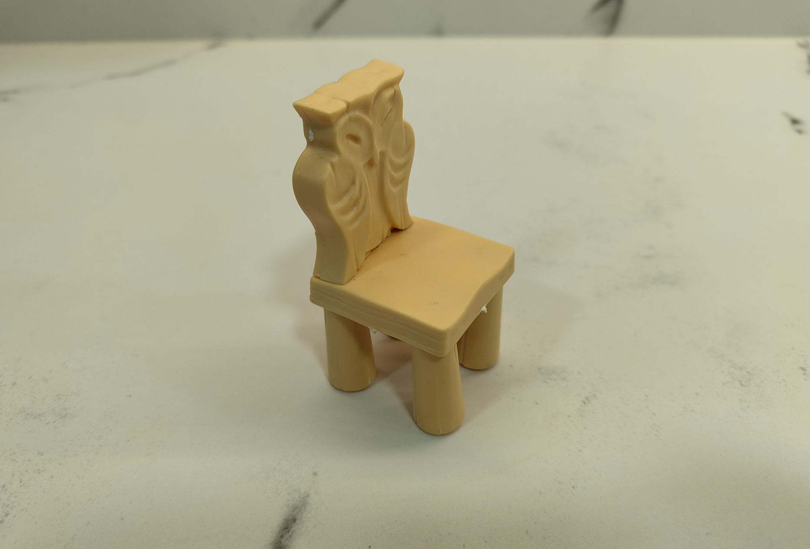
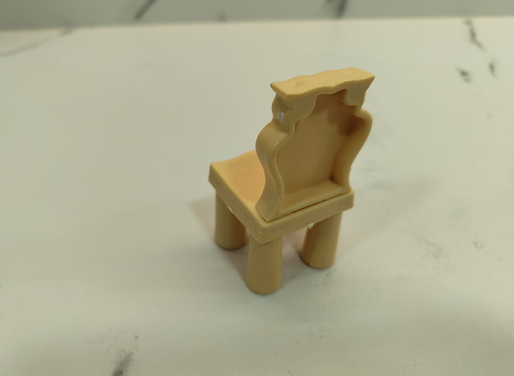
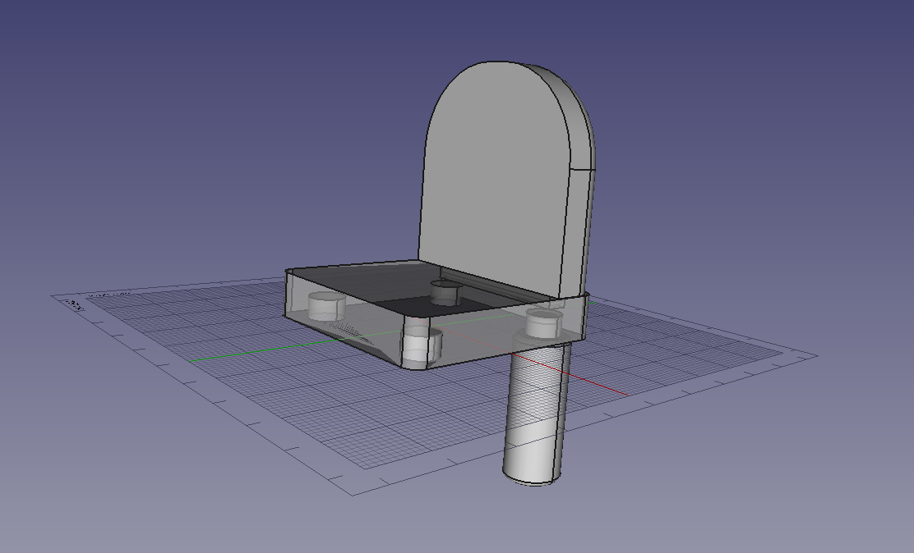
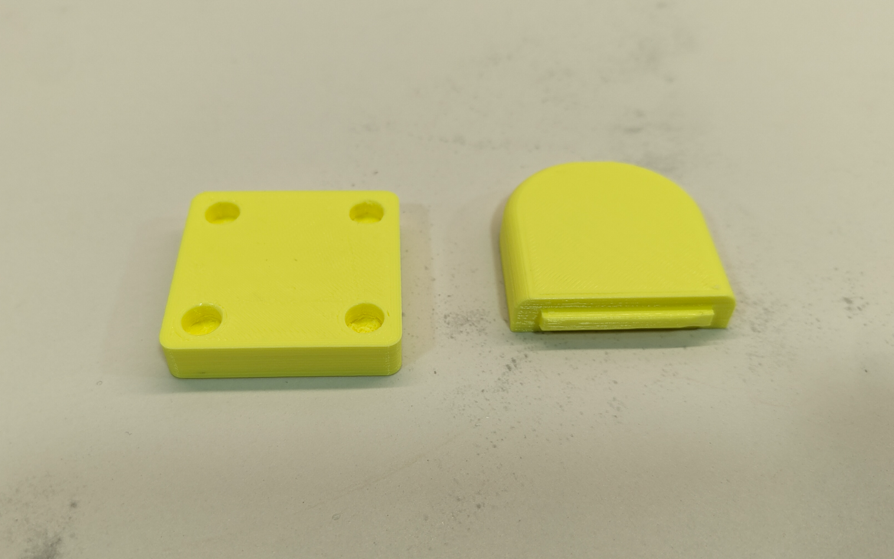
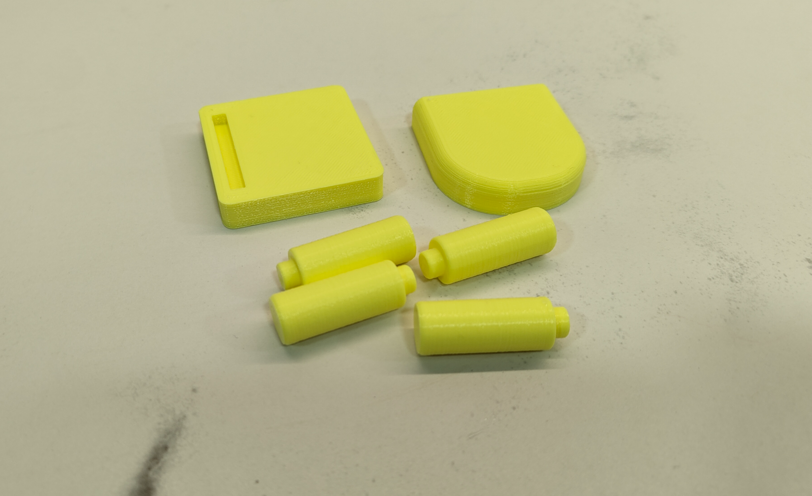
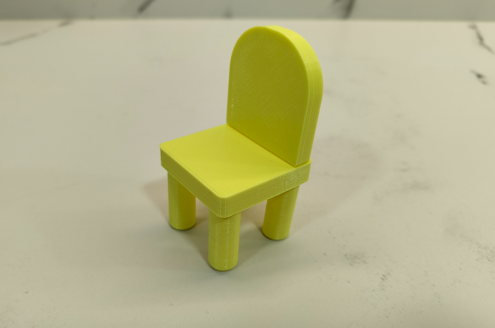
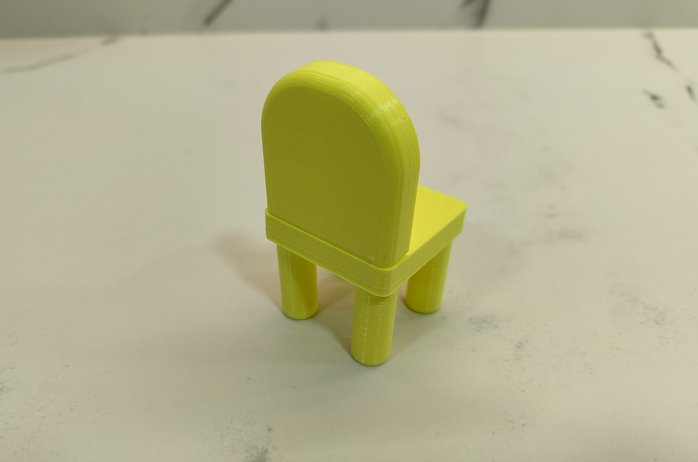

# 3D-Printed Toy Chair

Replacement chairs for a children's playset, designed in FreeCAD and 3D printed in three parts: seat, backrest, and legs.

## Why

We needed to replace a couple of chairs from a children's playset, and finding exact spares was not an option. So we took the original chairs as a reference and designed our own printable version.

| Reference photo 1 | Reference photo 2 |
|---|---|
|  |  |

## Design

The chair was modeled in FreeCAD and split into three parts:

| Part | File | Qty |
|---|---|---|
| Seat | [`stl/seat.stl`](stl/seat.stl) | 1 |
| Backrest | [`stl/backrest.stl`](stl/backrest.stl) | 1 |
| Leg | [`stl/leg.stl`](stl/leg.stl) | 4 |

The full parametric model lives in [`freecad/toy-chair.FCStd`](freecad/toy-chair.FCStd).

## Assembly

The parts fit together to build the chair.

## Result

The finished replacement chair, ready for the playset:

## License

This work is licensed under the [Creative Commons Attribution-ShareAlike 4.0 International License](http://creativecommons.org/licenses/by-sa/4.0/).

Please read the [LICENSE](LICENSE.txt) file for more details.
